<p align="center">
  
  
  
</p>
<br>

# Jellyfish Theme | 


This theme is heavily inspired by [Flow](https://github.com/LitCastVlog/Flow), [Zesty](https://github.com/stpnwf/ZestyTheme) and [Ultrachromic](https://github.com/CTalvio/Ultrachromic)
I've made a few tweaks and modifications of my own.

Login page backgrounds from [@ksushlapush](https://unsplash.com/@ksushlapush)

> [!IMPORTANT]
> `theme.css` is now the **only** stylesheet - it targets **Jellyfin 10.11+** natively, and includes the React/MUI top bar & nav drawer rules needed for Jellyfin 12's "modern" layout (formerly a separate `12_fixes.css` import). Just import `theme.css`, no extra file needed for normal pages.
>
> The admin dashboard is a special case: Jellyfin [removed the ability](https://github.com/jellyfin/jellyfin-web/issues/7220#issuecomment-3427290912) to theme it via Custom CSS Code, so `theme.css`'s dashboard-only section only takes effect through the JS-injection workaround (see [Dashboard Theming](scripts/README.md#dashboard-theming)) - most users don't need to set that up at all, it's only for admins who want the dashboard itself themed.
>
> If you're still on **Jellyfin 10.10.x or older**, the theme should mostly still work (there's a legacy fallback for the old detail-page markup), but it's no longer the primary target and minor misalignments are possible.


## 📑 Table of Contents

  - [Installation](#installation)
    - [Globally for all users](#globally-for-all-users)
    - [User/Device-Specific Theme (Display Settings)](#userdevice-specific-theme-display-settings)
  - [Theme](#theme)
    - [📝 Companion Scripts](#-companion-scripts)
    - [🎨 Colors:](#-colors)
  - [Recommended Plugins](#recommended-plugins)
  - [🧪 Compatibility](#-compatibility)
  - [Enjoying Jellyfish?](#enjoying-jellyfish)


## Installation

### Globally for all users


To apply a theme globally to all users via the Dashboard:

1.  **Navigate to Dashboard Settings**
    -   Log in as an administrator
    -   Go to **Dashboard** → **General** → **Custom CSS Code**
2.  **Add Import Statement**
    -   In the Custom CSS field, add all the desired `@import` statements:

```css
   @import url("https://cdn.jsdelivr.net/gh/n00bcodr/jellyfish@main/theme.css");
   @import url("https://cdn.jsdelivr.net/gh/n00bcodr/jellyfish@main/indicators.css");
   @import url("https://cdn.jsdelivr.net/gh/n00bcodr/jellyfish@main/progress_bar.css");
   /* Any other imports or custom CSS will go here */
```
3.  **Save Changes**
    -   Click **Save** at the bottom of the page
    -   Refresh your browser to see the changes

### User/Device-Specific Theme (Display Settings)

Individual users can apply the theme to their own account without affecting others:

1.  **Navigate to User Settings**
    -   Click on your profile icon
    -   Go to **Settings** → **Display** → **Custom CSS Code**
2.  **Add Import Statement**
    -   In the Custom CSS field, add your `@import` statement:


```css
   @import url("https://cdn.jsdelivr.net/gh/n00bcodr/Jellyfish/colors/peach.css");
```

3.  **Save and Refresh**
    -   Click **Save**
    -   Refresh the page to apply the theme

> [!Note]
> If you only want to change the color you can simply add import statement for the color you want. <br>
> If you want to replace the entire CSS for that device, you can choose 'Disable server-provided custom CSS code' and add the CSS statements in user display settings page as you prefer.

----
## Theme
\
**Main Theme with JellyBlue as default**

``` css
@import url("https://cdn.jsdelivr.net/gh/n00bcodr/Jellyfish/theme.css");
```

<table align="center">
  <tr>
    <th style="text-align:center; text-decoration: none;">Home<sup><a href="https://github.com/IAmParadox27/jellyfin-plugin-media-bar/" target="_blank" style="text-decoration: none;">**</a></sup></th>
    <th style="text-align:center">Item Details</th>
  </tr>
  <tr>
    <td>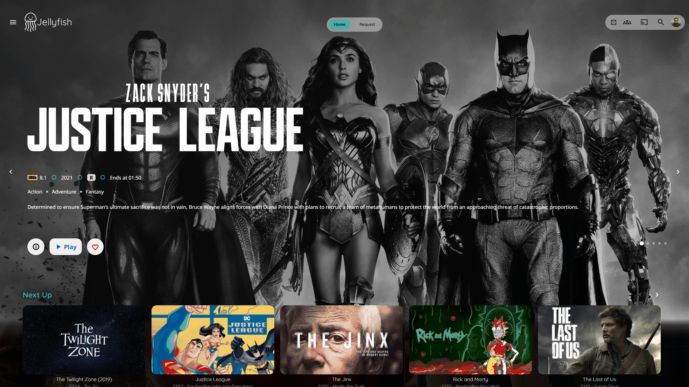</td>
    <td>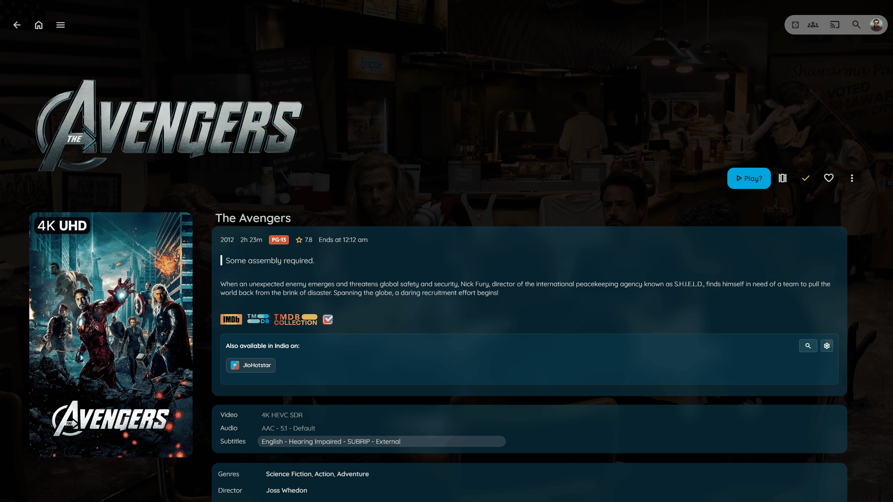</td>
  </tr>
  <tr>
    <th style="text-align:center">Login I</th>
    <th style="text-align:center">Login II</th>
  </tr>
  <tr>
    <td></td>
    <td></td>
  </tr>
</table>


<p align="center">
----
</p>

**Floating Progress Bar**

``` css
@import url("https://cdn.jsdelivr.net/gh/n00bcodr/Jellyfish/progress_bar.css");
```
<table align="center">
  <tr>
    <th style="text-align:center">Without</th>
    <th style="text-align:center">With</th>
  </tr>
  <tr>
    <td></td>
    <td></td>
  </tr>
</table>


<p align="center">
----
</p>

**Indicators attached in the corner**

Flush to the card corner on tablets and larger screens. On phones the theme's inset, rounded badges are used instead (corner-hugging badges are clipped by the card's rounded corner and are hard to read on narrow cards).

``` css
@import url("https://cdn.jsdelivr.net/gh/n00bcodr/Jellyfish/indicators.css");
```
<table align="center">
  <tr>
    <th style="text-align:center">Without</th>
    <th style="text-align:center">With</th>
  </tr>
  <tr>
    <td></td>
    <td></td>
  </tr>
</table>


<p align="center">
----
</p>

**Show Scrollbars**
`theme.css` hides scrollbars by default. Import this to bring them back.

``` css
@import url("https://cdn.jsdelivr.net/gh/n00bcodr/Jellyfish/scrollbar.css");
```

<p align="center">
----
</p>

**Watched / Favorite Buttons on Card Hover**
`theme.css` hides the watched and favorite buttons shown when hovering a card. Import this to show them again.

``` css
@import url("https://cdn.jsdelivr.net/gh/n00bcodr/Jellyfish/card_buttons.css");
```

<p align="center">
----
</p>

**Jellyfin Enhanced add-on** (optional, if you use the [Jellyfin Enhanced](https://github.com/n00bcodr/Jellyfin-Enhanced) plugin)
\
Styles the plugin's header "More" menu, the active-streams panel, form-control fonts and the plugin's own CSS variables - none of which go through its Themer - and fixes the icon tray collapsing into "..." when [KefinTweaks](https://github.com/ranaldsgift/KefinTweaks) breadcrumbs are on. Import it **after** `theme.css` (and your palette).

``` css
@import url("https://cdn.jsdelivr.net/gh/n00bcodr/Jellyfish/jellyfin-enhanced.css");
```

<p align="center">
----
</p>

**Text Instead of Icons**
\
\
In item details page, show text for Play, Trailer, Mark as watched etc.

``` css
@import url("https://cdn.jsdelivr.net/gh/n00bcodr/Jellyfish/icontext.css");
```
<table align="center">
  <tr>
    <th style="text-align:center">Without</th>
    <th style="text-align:center">With</th>
  </tr>
  <tr>
    <td></td>
    <td></td>
  </tr>
</table>


<p align="center">
----
</p>

**Coloured Parental Ratings**


> [!NOTE]
> Only works with a custom [javascript](scripts/rating.js)

``` css
@import url("https://cdn.jsdelivr.net/gh/n00bcodr/Jellyfish/ratings.css");
```

<p align="center">
----
</p>


<h3> Logo</h3>

Streamberry Logo (inspired by Black Mirror) instead of Jellyfish Logo. Included by default with [jellyflix.css](colors/jellyflix.css)

``` css
@import url("https://cdn.jsdelivr.net/gh/n00bcodr/Jellyfish/streamberry_logo.css");
```
<p align="center">
----
</p>

## 📝 Companion Scripts

[Readme.md](/scripts/README.md)

---
## 🎨 Colors

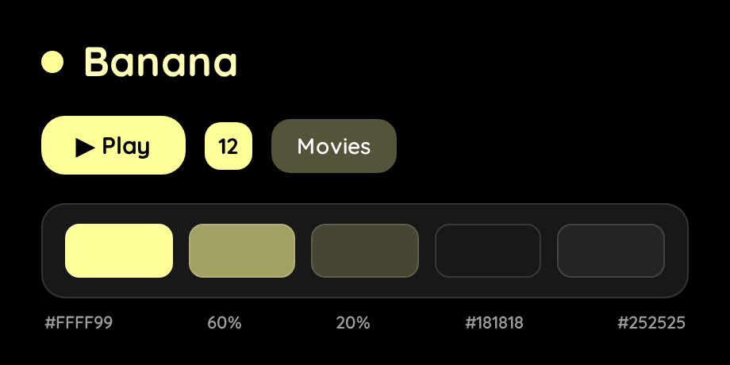

``` css
@import url("https://cdn.jsdelivr.net/gh/n00bcodr/Jellyfish/colors/banana.css");
```

<p align="center">
----
</p>

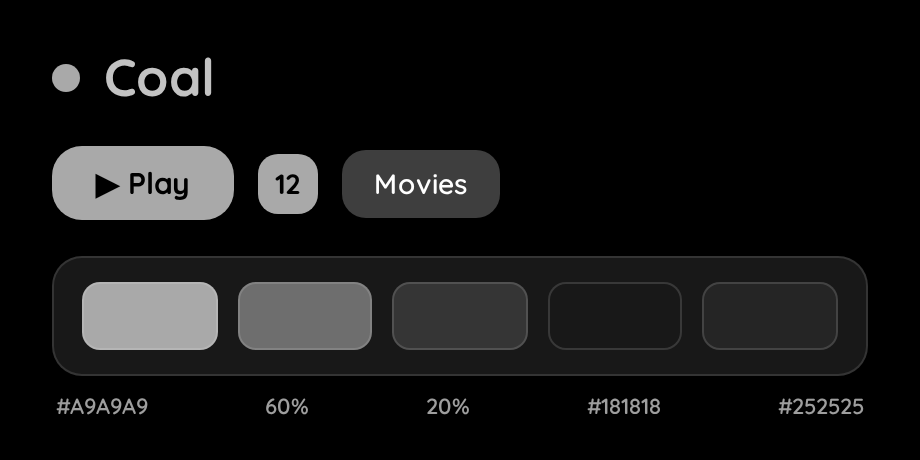

``` css
@import url("https://cdn.jsdelivr.net/gh/n00bcodr/Jellyfish/colors/coal.css");
```
<p align="center">
----
</p>

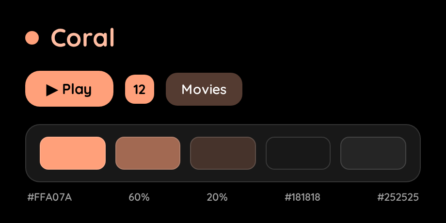

``` css
@import url("https://cdn.jsdelivr.net/gh/n00bcodr/Jellyfish/colors/coral.css");
```
<p align="center">
----
</p>

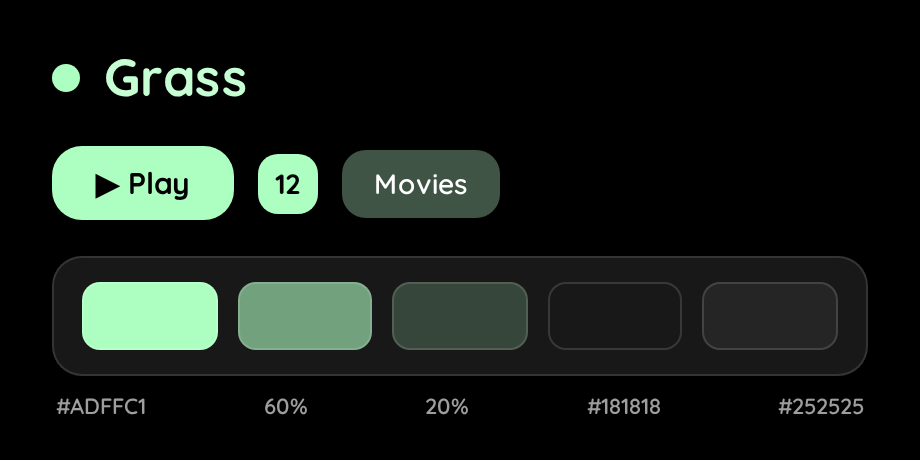

``` css
@import url("https://cdn.jsdelivr.net/gh/n00bcodr/Jellyfish/colors/grass.css");
```
<p align="center">
----
</p>

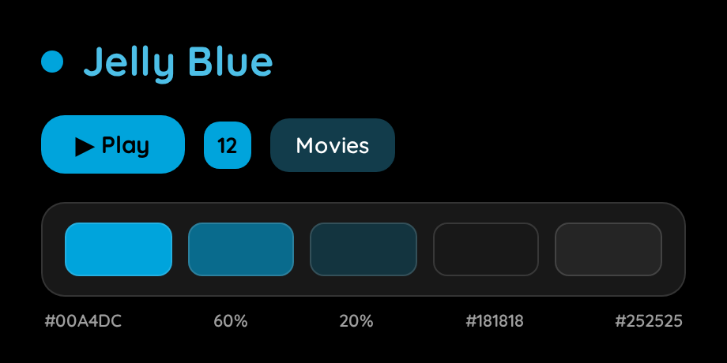

``` css
@import url("https://cdn.jsdelivr.net/gh/n00bcodr/Jellyfish/colors/jellyblue.css");
```
<p align="center">
----
</p>

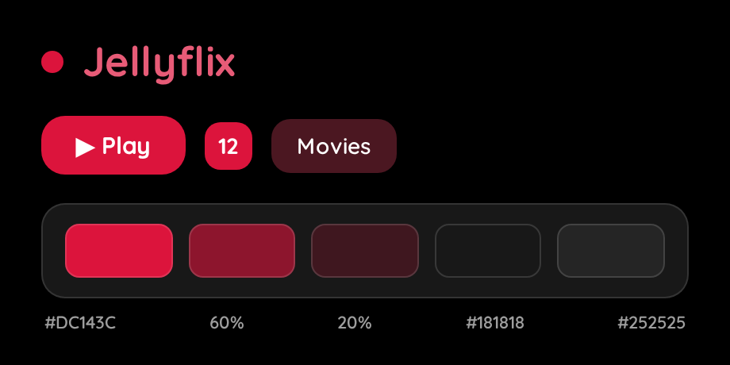

``` css
@import url("https://cdn.jsdelivr.net/gh/n00bcodr/Jellyfish/colors/jellyflix.css");
```
<p align="center">
----
</p>

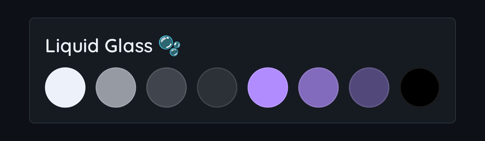

**Liquid Glass** — an Apple-"Liquid Glass"-inspired palette: neutral graphite, a pearl-white accent and a soft iridescent glow, so the color comes from your artwork rather than a blue tint (change `--primary-r/g/b` in the file for a tinted variant). Besides the usual colors it makes the header, drawer, menus, dialogs, A-Z picker and buttons frosted, translucent glass with a bright edge highlight. Needs a browser with `backdrop-filter` (every current Chrome/Edge/Safari/Firefox); older engines fall back to solid panels.

``` css
@import url("https://cdn.jsdelivr.net/gh/n00bcodr/Jellyfish/colors/liquidglass.css");
```
<p align="center">
----
</p>

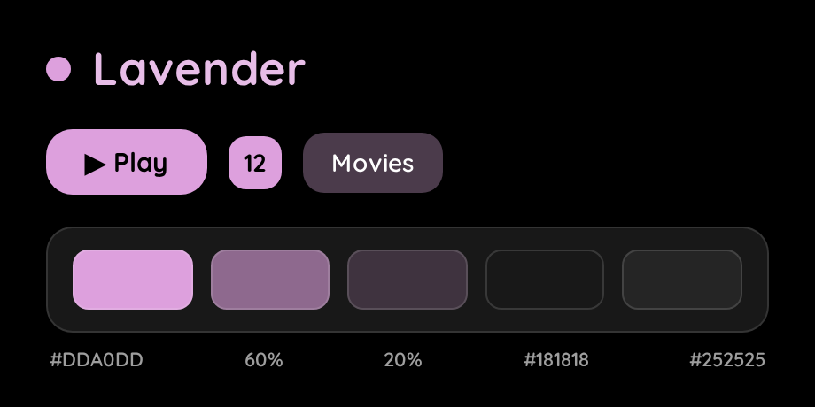

``` css
@import url("https://cdn.jsdelivr.net/gh/n00bcodr/Jellyfish/colors/lavender.css");
```
<p align="center">
----
</p>

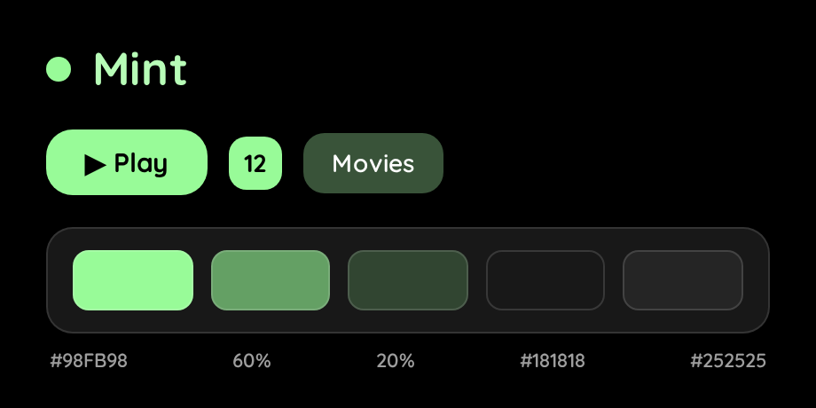

``` css
@import url("https://cdn.jsdelivr.net/gh/n00bcodr/Jellyfish/colors/mint.css");
```
<p align="center">
----
</p>

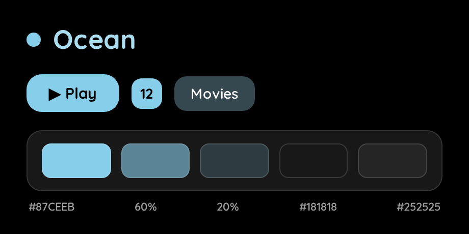

``` css
@import url("https://cdn.jsdelivr.net/gh/n00bcodr/Jellyfish/colors/ocean.css");
```
<p align="center">
----
</p>

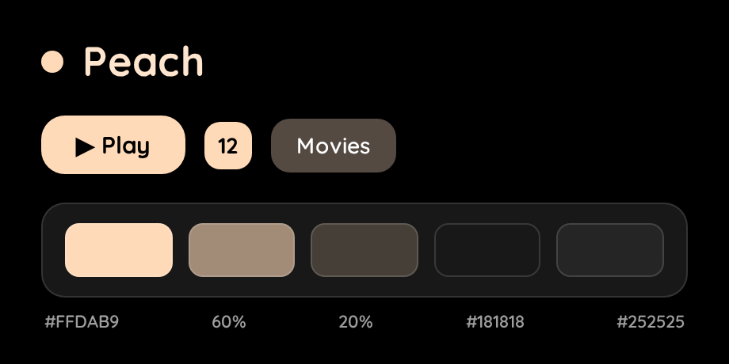

``` css
@import url("https://cdn.jsdelivr.net/gh/n00bcodr/Jellyfish/colors/peach.css");
```
<p align="center">
----
</p>

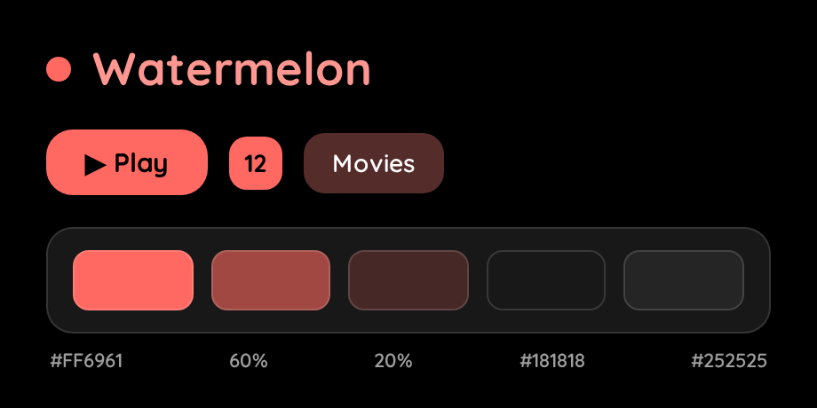

``` css
@import url("https://cdn.jsdelivr.net/gh/n00bcodr/Jellyfish/colors/watermelon.css");
```

<p align="center">
----
</p>

**More palettes** (no swatch image yet): `aurora`, `forest`, `jellypurple`, `midnight`

``` css
@import url("https://cdn.jsdelivr.net/gh/n00bcodr/Jellyfish/colors/aurora.css");
```

### Making your own palette

A palette is just a handful of CSS variables - copy any file in [`colors/`](colors/) and change these:

| Variable | What it is |
|---|---|
| `--primary-r/g/b` | The accent color as three numbers (`0..255`) |
| `--primary-background-color` / `--secondary-background-color` | Page background / drawer, cards, dialogs (keep both **dark**) |
| `--text-color` | Text drawn **on top of the solid accent** (Play button, active tab, unwatched count). Use `#000000` for light accents and `#ffffff` for dark ones - aim for ≥ 4.5:1 contrast |
| `--header-background-color` | The frosted pill behind the header tabs (legacy/TV layouts) |

Everything else (readable accent-colored text, tinted selected rows and dialogs, the whole Jellyfin 12 palette) is **derived automatically** from those values by `theme.css`, so a new palette stays readable without further work.

### Quick tweaks

Add these *after* the theme import in Custom CSS to adjust the look without editing any file:

``` css
:root {
  --rounded-cards: 10px;   /* corner radius of cards, panels and buttons (default 15px) */
  --blur: 8px;             /* strength of the frosted-glass blur; lower = faster on weak devices */
  --indicator-size: 28px;  /* size of the watched / unwatched-count badges on cards */
}
```

## Recommended Plugins

To completely replicate the look in the screenshots you'd need the below plugins installed and configured
- [jellyfin-plugin-media-bar](https://github.com/IAmParadox27/jellyfin-plugin-media-bar)
- [jellyfin-plugin-custom-tabs](https://github.com/IAmParadox27/jellyfin-plugin-custom-tabs)
- [Jellyfin-Enhanced](https://github.com/n00bcodr/Jellyfin-Enhanced/)

## 🧪 Compatibility

- Works for Movies and TV Shows, should work fine mostly for Music and Books, although I don't use Jellyfin for either of them
- Works on both mobile app and web browser, known to have issues / not work on Jellyfin Media Player
- **Jellyfin 12 layouts** (Settings → Display → Display mode): checked on 12.2 in the *Modern*/*Desktop*/*Mobile* layouts (the React app) and in the legacy *Desktop (legacy)*, *Mobile (legacy)* and **TV** layouts. The TV layout is a legacy-app layout in Jellyfin 12, so it uses the same stylesheet rules as the legacy desktop/mobile layouts, with larger A-Z letters and no blur effects (TV GPUs are weak).
- **Screen sizes**: from ~360px phones through tablets and narrow/tiled desktop windows to 4K TVs at 200-250% scale. The A-Z picker always fits the viewport height, card badges scale with the screen, and the item page switches to a flowing title block below 1280px.


> [!NOTE]
> Jellyfin for good reason [removed the ability](https://github.com/jellyfin/jellyfin-web/issues/7220#issuecomment-3427290912) to add custom CSS in the dashboard in version 10.11.
>
> So direct theming for the admin dashboard does not work, and that is expected.
>
> Look at [10.11 Dashboard Theming](scripts/README.md#1011-dashboard-theming) for a work around. Try at your own risk!


> [!NOTE]
> This theme like many others themes works best only when you have Backdrops and Details Banner enabled in display settings
>
> Get the Plugin [JellyfinTweaks](https://github.com/n00bcodr/JellyfinTweaks) for a way to force enable the above two and more on all your devices.


---

<div align="center">

**Made with 💜 for Jellyfin and the community**

### Enjoying Jellyfish?

Checkout my other repos!

[Jellyfin-Enhanced](https://github.com/n00bcodr/Jellyfin-Enhanced) (javascript) • [Jellyfin-Elsewhere](https://github.com/n00bcodr/Jellyfin-Elsewhere) (javascript) • [Jellyfin-Tweaks](https://github.com/n00bcodr/JellyfinTweaks) (plugin) • [Jellyfin-JavaScript-Injector](https://github.com/n00bcodr/Jellyfin-JavaScript-Injector) (plugin) • [Jellyfish](https://github.com/n00bcodr/Jellyfish/) (theme)


</div>
